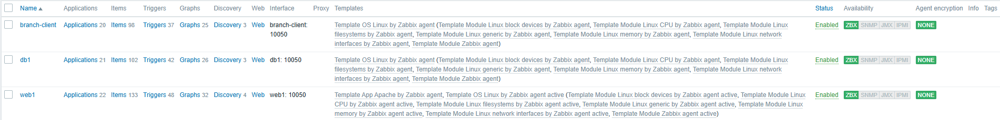
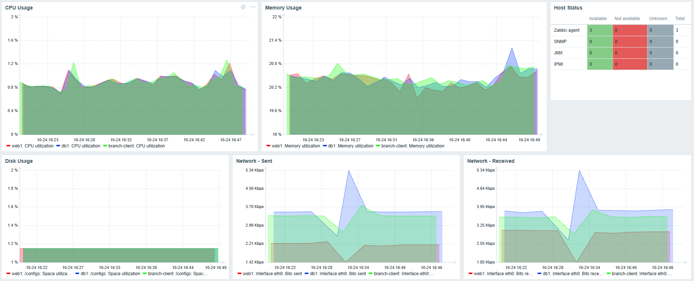
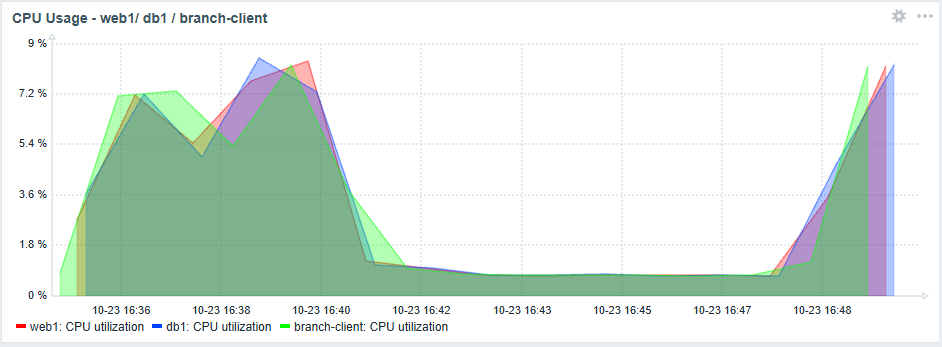
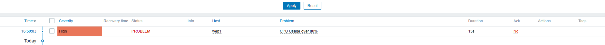
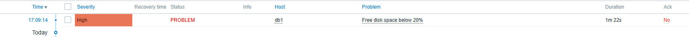
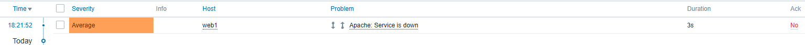

# Viikko 6 – Zabbix ja keskitetty verkonvalvonta

## 1. Johdanto

Zabbix on avoimen lähdekoodin valvontaohjelmisto, jota käytetään verkkojen, palvelimien ja palveluiden toiminnan seuraamiseen. Sen avulla voidaan valvoa esimerkiksi prosessorin kuormitusta, muistinkäyttöä, levytilaa, verkkoliikennettä ja laitteiden saatavuutta.

Zabbix kerää mittaustietoja esimerkiksi laitteisiin asennettujen agenttien avulla ja esittää ne kuvaajina sekä dashboard-näkymissä. Ohjelmistoon voidaan myös määrittää automaattisia hälytyksiä, joiden avulla ylläpitäjä saa tiedon mahdollisista ongelmatilanteista.

Tässä harjoituksessa Zabbixia käytetään Containerlab-ympäristön web1-, db1- ja branch-client-laitteiden keskitettyyn valvontaan.

## 2. Hostien lisääminen

Zabbixiin lisättiin Containerlab-ympäristöstä kolme valvottavaa laitetta: web1, db1 ja branch-client. Laitteisiin asennettiin Zabbix Agent 2, jonka avulla Zabbix kerää mittaustietoja.

Hosteille määritettiin DNS-nimet, portti 10050 sekä sopivat Linux-valvontatemplatet. Web1:lle oli määritetty aktiivinen Zabbix-agentin template sekä Apachen valvontaan tarkoitettu template. Db1:llä ja branch-clientillä käytettiin tavallista Linux by Zabbix agent -templatea.

Valvonnassa seurattiin esimerkiksi seuraavia tietoja:

- Prosessorin kuormitus (CPU)
- Muistinkäyttö (Memory)
- Levytilan käyttö (Disk)
- Verkkoliikenne (Network traffic)
- Laitteen käynnissäoloaika (Uptime)
- Laitteen saatavuus (Availability)

Laitteiden lisäämisen jälkeen tarkistettiin, että kaikkien kolmen hostin ZBX-merkintä oli vihreä ja mittaustiedot päivittyivät Zabbixin Latest data -näkymässä.

Kuva 1. Zabbixiin lisätyt hostit ja niiden toimivat agenttiyhteydet.



## 3. Dashboard

Zabbixiin luotiin Golden Topology Status -niminen dashboard, jonka avulla voidaan seurata Containerlab-ympäristön laitteiden toimintaa yhdestä näkymästä.

*Kuva 2. Kuvakaappaus luodusta dashboardista.*



## 4. Mittarit

Taulukossa on käytetty web1:n mittareiden arvoja:

| Mittari | Arvo | Merkitys |
|---|---|---|
| **CPU utilization** | 0,91 % | Näyttää prosessorin kuormituksen ja auttaa havaitsemaan ylikuormituksen. |
| **Memory utilization** | 20,20 % | Kertoo muistinkäytöstä ja auttaa havaitsemaan muistin loppumisen. |
| **Load average (1 min)** | 0,1611 | Kuvaa järjestelmän keskimääräistä kuormitusta ja auttaa havaitsemaan pitkäkestoista kuormitusta. |
| **System uptime** | 1 h 24 min 56 s | Kertoo, kuinka pitkään järjestelmä on ollut käynnissä. Auttaa havaitsemaan uudelleenkäynnistykset. |
| **Network traffic** | Received – 3,82 Kbps; Sent – 3,58 Kbps | Näyttää vastaanotetun ja lähetetyn verkkoliikenteen sekä auttaa havaitsemaan poikkeamia. |

## 5. Triggerit

Zabbixiin määritettiin kaksi triggeriä, joiden avulla voidaan havaita laitteiden resurssien käyttöön liittyviä ongelmatilanteita.

| Triggeri | Laite | Hälytysehto | Vakavuus |
|---|---|---|---|
| CPU usage over 80% | web1 | Prosessorin käyttöaste ylittää 80 %. | High |
| Free disk space below 20% | db1 | Käytetty levytila ylittää 80 %, eli vapaata tilaa on alle 20 %. | High |

Triggerit seuraavat Zabbixin keräämiä mittaustietoja ja muodostavat hälytyksen, kun määritetty ehto täyttyy. Hälytykset näkyvät Monitoring → Problems -näkymässä.

Triggerien toimintaa testattiin laskemalla hälytysrajoja väliaikaisesti. Testien jälkeen alkuperäiset hälytysrajat palautettiin.

## 6. Hälytys- ja häiriötestit

### CPU-kuormitustesti

CPU-triggerin alkuperäinen hälytysraja oli 80 %, mutta testin ajaksi se laskettiin 6 prosenttiin. Web1-palvelimelle aiheutettiin prosessorikuormitusta, jotta hälytysraja ylittyisi.

*Kuvat 3 ja 4. CPU:n käyttöasteen nousu yli testirajan ja siitä syntynyt hälytys.*





**Tulos:** Zabbix muodosti CPU-hälytyksen noin 30 sekuntia raja-arvon ylittymisen jälkeen.

### Levytilan kulutustesti

db1-palvelimen levytilan kulutusta testattiin luomalla noin 1 GB:n kokoinen testitiedosto komennolla:

```bash
dd if=/dev/zero of=/configs/testfile.img bs=1M count=1000
```

Levytilan hälytysraja laskettiin testin ajaksi 1,30 prosenttiin, koska valvottava levyalue oli suuri.

*Kuva 5. Levytilan triggerhälytys.*



**Tulos:** Levytilan käyttö ylitti määritetyn raja-arvon, ja Zabbix muodosti hälytyksen noin 30 sekunnissa.

### Apache-palvelun häiriötesti

Häiriötilannetta simuloitiin pysäyttämällä web1-palvelimen Apache-palvelu komennolla `service apache2 stop`.

*Kuva 6. Apache-palvelun pysähtymisestä syntynyt hälytys.*



**Tulos:** Zabbix havaitsi palvelun pysähtymisen noin 30 sekunnissa ja näytti Monitoring → Problems -näkymässä hälytyksen `Apache: Service is down`.

## 7. Vertailu

Seuraavassa taulukossa vertaillaan SNMP:n, Prometheuksen ja Zabbixin ominaisuuksia.

| Ominaisuus | SNMP | Prometheus | Zabbix |
|---|---|---|---|
| Tiedonkeruu | SNMP:n avulla valvontaohjelmisto kysyy laitteiden tietoja. | Kerää mittareita esimerkiksi Node Exporterin avulla. | Kerää tietoja agenttien, SNMP:n ja muiden menetelmien avulla. |
| Dashboardit | Vaatii erillisen valvontaohjelmiston. | Perusnäkymä löytyy, mutta visualisointiin käytetään usein Grafanaa. | Sisäänrakennetut dashboardit ja kuvaajat. |
| Hälytykset | Hälytyksiä voidaan toteuttaa erillisen valvontaohjelmiston ja SNMP Trap -viestien avulla. | Hälytyssäännöt ja Alertmanager. | Sisäänrakennetut triggerit ja hälytykset. |
| Käyttöönotto | Agentin määritys on melko yksinkertaista, mutta tietojen käsittely vaatii valvontatyökalun. | Vaatii Prometheuksen ja valvottaville laitteille esimerkiksi Node Exporterin. | Vaatii Zabbix-palvelimen sekä valvottavien laitteiden ja templatejen määrittämisen. |
| Skaalautuvuus | Soveltuu suurten laitemäärien valvontaan valvontaohjelmiston mukaan. | Soveltuu laajoihin ympäristöihin, ja sitä voidaan laajentaa useilla palvelimilla. | Tukee suuria ympäristöjä esimerkiksi Zabbix Proxyjen avulla. |
| Yrityskäyttö | Käytetään erityisesti verkkolaitteiden valvonnassa. | Soveltuu hyvin palvelin-, sovellus- ja pilviympäristöjen valvontaan. | Kattava ratkaisu yritysten verkkojen, palvelimien ja palveluiden valvontaan. |

Harjoitusten perusteella Zabbix soveltuu hyvin keskitettyyn valvontaan, koska mittaukset, dashboardit ja hälytykset löytyvät samasta käyttöliittymästä. Prometheus puolestaan sopii erityisesti mittaustietojen keräämiseen ja analysointiin esimerkiksi Grafanan avulla, kun taas SNMP:tä voidaan hyödyntää verkkolaitteiden valvonnassa.

## 8. Yhteenveto

Verkonhallinta-kurssilla opin paljon uutta, sillä lähes kaikki käsitellyt aiheet olivat minulle entuudestaan vieraita. Opin rakentamaan verkkoympäristöjä Containerlabin ja Dockerin avulla sekä käyttämään Linuxin komentoriviä.

Kurssin tärkeimpiä oppeja olivat SNMP:n käyttö, Prometheuksen ja Grafanan avulla tehtävä valvonta, Ansiblen hyödyntäminen automaatiossa sekä Zabbixin käyttö keskitettyyn valvontaan ja hälytysten määrittämiseen.

Kurssi auttoi ymmärtämään, kuinka tärkeää verkkojen ja palvelimien jatkuva seuranta on. Lisäksi opin selvittämään ongelmatilanteita ja käyttämään erilaisia verkonhallintatyökaluja käytännössä. Keskitetty valvonta helpottaa ongelmien havaitsemista, koska useiden laitteiden toimintaa voidaan seurata yhdestä paikasta.
